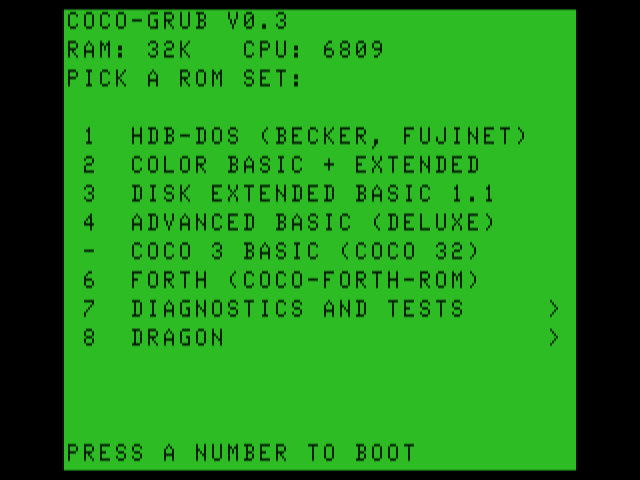
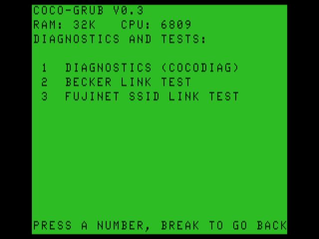
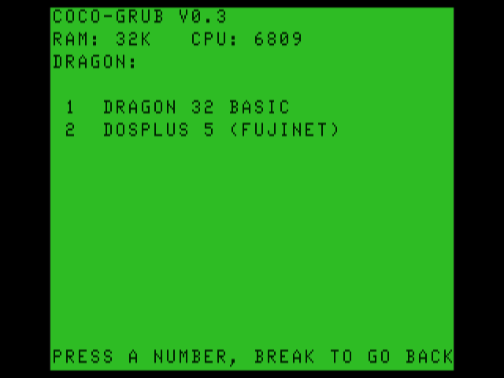
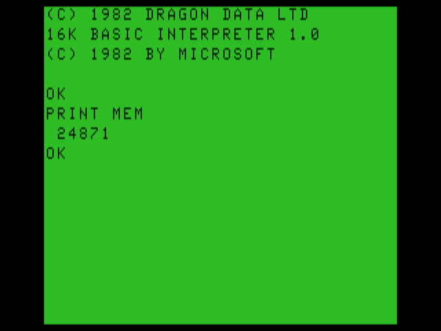

# coco-grub

A boot menu for the Tandy Color Computer, served by a One ROM. At power-on the
CoCo shows a menu, and the chosen ROM set is then served in place of the menu
and cold-started.

## Screenshots

| | |
| --- | --- |
|  |  |
| The menu. `>` marks a submenu. | A submenu. BREAK goes back. |
|  |  |
| The Dragon submenu. | Dragon 32 BASIC on a CoCo 2, typed on the CoCo's keyboard. |

Taken in XRoar, running this menu ROM and the patched Dragon 32 ROM on an
emulated CoCo 2. XRoar's CoCo 2 gives the menu 32K, so CoCo 3 BASIC, which
needs 64K, shows `-` in place of its number. A 64K CoCo shows its number.

## Targets

1. **First:** CoCo 2 26-3134 and 26-3136. Color BASIC and Extended Color BASIC
   share a single 27128 in one motherboard socket.
2. **Later:** CoCo 1 and CoCo 2 boards with two 2764 sockets, one for Color
   BASIC and one for Extended Color BASIC.

## Using the cartridge select without a cartridge

One ROM can serve a second ROM image at the same time as the first, selected by
its own chip-select line through the X1 or X2 pin. This is a "multi-ROM slot"
(see One ROM's `docs/MULTI-ROM-SETS.md`, which fire-28-c supports).

The plan is to wire CTS\* to one of these pins with a flying lead. One ROM then
answers reads at $C000–$DFFF as well, so HDB-DOS runs from the motherboard
socket with nothing in the cartridge slot.

This works on a 26-3134. Disk Extended BASIC 1.1 boots from X1 with no cartridge
fitted; the config is `configs/coco2-27128-disk11.json`.

Two things about this board shape every config:

- **OE (pin 22) is tied active.** Both chips must mark `oe` as `ignore`, so CE
  (pin 20) alone selects BASIC and CTS\* alone selects the X1 chip. Chip 0 also
  needs `allow_cs_ignore`. With OE left in, One ROM treats it as a chip select
  that is always active, drives the data bus on every cycle, and the CoCo
  doesn't boot.
- **The slot's table is 512KB, so there is only one RAM slot.** The menu can't
  load an entry into a second RAM slot and switch to it. Instead the plugin
  copies the entry over the live slot while the CoCo runs from its own RAM.

CTS\* selects all of $C000–$FEFF, so the X1 chip is a 27128. An 8K cartridge
ROM is stored twice over in its 16K, as a real 2764 appears in that window.

On the two-socket boards, the Extended BASIC socket's chip select takes the
other X pin. That gives three images in one slot: BASIC, Extended BASIC and
HDB-DOS. Three is the most a multi-ROM slot holds.

## Menu entries

`menu.json` sets the menu at build time. It may become configurable at run
time later.

| Key | Entry | Notes |
| --- | --- | --- |
| 1 | HDB-DOS (Becker, FujiNet) | toolshed's hdbdw3bck on CTS\*, with One ROM's Becker port bridged to the FujiNet. |
| 2 | Color BASIC + Extended | |
| 3 | Disk Extended BASIC 1.1 | On CTS\*. |
| 4 | Advanced BASIC (Deluxe) | The Deluxe CoCo's BASIC, patched for the CoCo 2 by `~/deluxe-coco`. |
| 5 | CoCo 3 BASIC (Coco 32) | Coco 32, from the Color Computer Archive. Needs 64K. |
| 6 | Forth | hcgernhardtiii/coco-forth-rom, replacing Color BASIC. Built with asm6809. |
| 7 | Diagnostics and tests > | A submenu: varmfskii/cocodiag, and this repository's Becker and FujiNet SSID link tests. |
| 8 | Dragon > | A submenu: the Dragon 32's BASIC, patched by `patches/dragon32.asm` for the CoCo's keyboard wiring, and the same with DOSplus 5 and the DW42 extender on CTS\*, its Becker port at the Dragon's $FF49-$FF4A bridged to the FujiNet. |

An entry can be a submenu, one level deep, marked `>` at the end of its row.
Its entries are picked with keys 1-9 as at the top, and BREAK goes back.

The menu shows its version at the top left, and a status line under it with
the RAM size and whether the CPU is a 6809 or a 6309. An entry the machine
can't run - one needing 64K on a smaller machine, or the cartridge select with
a cartridge fitted - shows `-` in place of its number.

**To do:** a timer that boots a configurable entry if no key is pressed.

## Booting and RESET

The CoCo fetches its reset vector from $FFFE, which the SAM maps to $BFFE, the
top of the motherboard socket. So the boot slot's chip 0 is the grub image: menu
code at $8000-$BFFF with its own reset vector. Choosing an entry copies that
entry's image over the live slot and jumps through its reset vector.

- **Power-on goes to grub.** One ROM is powered from the socket, so a power
  cycle restarts it into the grub slot.
- **RESET stays in the chosen system,** as it would with a real ROM. Many games
  need RESET pressed to get artifact colours right, and BASIC's warm start
  relies on it too.
- **To do:** holding a key through RESET returns to grub. One ROM doesn't see the
  RESET line, so this needs the plugin to watch for the reset vector fetch, or
  RESET wired to a spare pin.

## DriveWire plugin

The aim is a single build of the One ROM DriveWire plugin that works whether
HDB-DOS sits in the cartridge slot or in the motherboard socket.

## Building

`menu.json` lists the menu's entries. `fetch.py` fetches and builds the
third-party ROMs it names into `roms/`, each pinned to a commit or a SHA-256,
and `build.py` turns it into a One ROM firmware image:

    ./fetch.py
    ./build.py --onerom <onerom CLI> --base-firmware <onerom-rp235x.bin> \
               --plugin <drivewire_plugin.bin>

The base firmware and plugin come from the `rebase-v0.8.0` branch of the
one-rom fork. The firmware needs that fork's local plugin API extensions, and
the CLI must be new enough to read v0.8.0 firmware. The result goes to
`build/coco-grub.bin`, with the One ROM config beside it in `build/onerom.json`.
`--debug-halt` stops the menu straight after it signals the plugin, so One ROM's
capture ring still holds the signal.

Each ROM gets a small single-chip flash slot, and the plugin copies an entry's
ROMs into the live slot when it's chosen. See `build.py` for the layout and
`src/grub.asm` for how the menu signals the plugin.

**Status (2026-11-06):** both milestone 1 entries load on a 26-3134, plain
BASIC and Disk Extended BASIC on CTS\*. Coco 32, the diagnostics and
Forth are in the menu, untested on hardware.

## ROM images

No ROM images are stored in this repository. The Tandy ROMs come from a local
dump in `roms/`. `fetch.py` fetches the rest: cocodiag is GPL-3.0, and
coco-forth-rom has no licence, so neither can be vendored as things stand.
